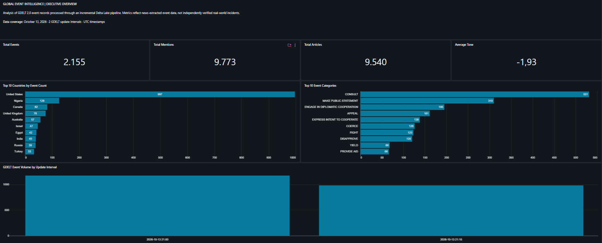
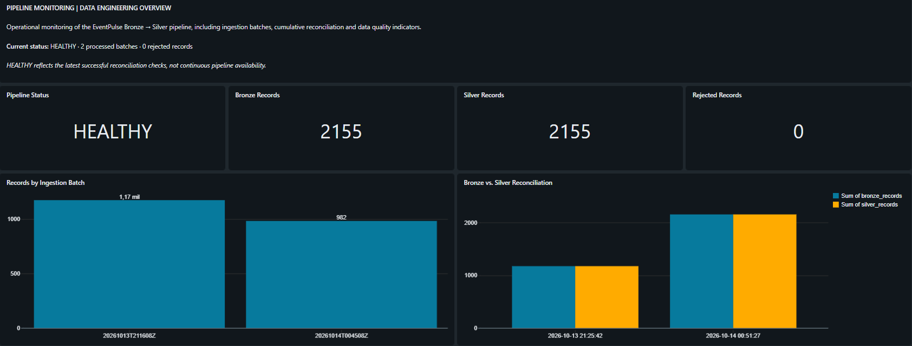

# EventPulse — Global Event Intelligence Lakehouse

**Automated Data Engineering Pipeline | Databricks · PySpark · Delta Lake · GDELT**

## Overview

EventPulse is an automated data engineering project that transforms global event data from the GDELT 2.0 Events dataset into structured, analytics-ready datasets using a Medallion Lakehouse architecture.

The pipeline retrieves new GDELT files, processes events incrementally, validates data quality, and generates analytical aggregations for monitoring international event activity.

## Architecture

**GDELT 2.0 Events → Source Ingestion → Bronze → Silver → Gold → Databricks Dashboards**

The architecture consists of four orchestrated tasks:

1. **Source Ingestion:** Discovers, downloads, validates, and stores new GDELT event files.
2. **Bronze:** Preserves source records and captures ingestion metadata.
3. **Silver:** Cleans and standardizes event data, applies validation rules, and handles incremental processing.
4. **Gold:** Produces analytical aggregations by date, geographic location, and event category.

The pipeline runs through Databricks Jobs with scheduled execution, task dependencies, failure notifications, and retry configuration.

## Technology Stack

- Python and PySpark
- Databricks Serverless
- Delta Lake
- Unity Catalog
- Databricks Workflows
- SQL
- Databricks AI/BI Dashboards
- Git and GitHub

## Data Quality and Reliability

EventPulse implements several controls:

- Source file validation against the expected 61-column GDELT structure
- File integrity verification using SHA-256
- Incremental ingestion and event deduplication
- Rejected-record handling and reconciliation checks
- Bronze, Silver, and Gold consistency validation
- Geographic reference mapping and handling of unknown or unmapped codes
- Auditing of geographic codes requiring further review

## Analytics

The Gold layer supports analysis of:

- Global event activity over time
- Event distribution by geographic location
- Event categories based on the CAMEO classification
- Media mentions and article counts
- Average event tone

## Pipeline Validation

During development, the pipeline successfully processed and reconciled over **36,000 events** across Bronze, Silver, and Gold.

The project also demonstrated incremental processing of multiple 15-minute GDELT files in a single scheduled workflow.

## Dashboards

### Global Event Intelligence

### Pipeline Monitoring

## Repository Structure

- `notebooks/` — Databricks notebooks for ingestion, transformation, analytics, and testing
- `src/` — Python utilities for downloading and preparing source data
- `docs/images/` — Dashboard and pipeline screenshots
- `data/` — Local source and staging files excluded from version control

## Data Source

Global Database of Events, Language, and Tone (GDELT), GDELT 2.0 Events.

https://www.gdeltproject.org/

GDELT captures events identified in news reporting. Its event classifications and geographic assignments reflect automated extraction and should not be interpreted as independently verified facts.

## Project Purpose

EventPulse demonstrates practical skills in Data Engineering, including ETL/ELT development, incremental ingestion, Lakehouse modeling, data quality validation, workflow orchestration, and analytical data preparation.